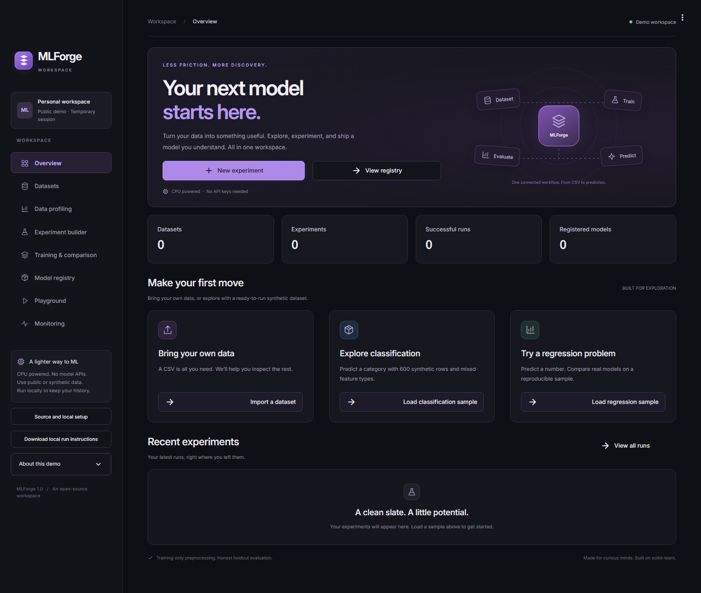
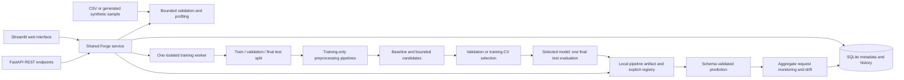

# MLForge — End-to-End Machine Learning Platform

A local, CPU-first workbench for **tabular classification and regression**. Take a CSV through validation, profiling, leakage-safe preprocessing, baseline/model comparison, final holdout evaluation, explainability, a versioned model registry, prediction and input-drift monitoring.

**[Open the live demo](https://mlforge-nine.vercel.app)** · **[GitHub repository](https://github.com/Ishita-2210/MLForge)** · **[Run locally](#run-on-windows)**

The live demo runs real CPU training and prediction in a temporary browser-session workspace. Models and history can disappear on restart or reconnection. Use synthetic/public data there. Run locally for private datasets, persistent history and the dedicated REST API. The hosted sidebar includes a downloadable local setup guide.

Streamlit provides the browser interface; FastAPI exposes predictions; both call the same independently testable Python services. SQLite stores history and metadata. The complete fitted scikit-learn pipeline is persisted with each model. No GPU, paid service, account, external database, model download or cloud inference is required.



The interface includes a responsive dashboard, direct sample-to-experiment actions, a compact icon sidebar and consistent forms/results styling. Inter is bundled locally under the [SIL Open Font License](app/ui/assets/fonts/LICENSE.txt); the interface does not need an external font service.

## Run on Windows

From PowerShell (the requested project folder is **`D:\ml forge`**):

The project already exists at that path on the original computer. On a different computer, clone it first:

```powershell
git clone https://github.com/Ishita-2210/MLForge.git 'D:\ml forge'
```

```powershell
cd 'D:\ml forge'
python -m venv .venv
.\.venv\Scripts\python -m pip install -r requirements-lock.txt
.\.venv\Scripts\python -m pip install -e . --no-deps --no-build-isolation
.\.venv\Scripts\python scripts/dev.py
```

Open **http://127.0.0.1:8501**. API documentation: **http://127.0.0.1:8000/docs**. Ctrl+C stops both owned services and their workers. Virtual-environment activation is optional; the commands above work without changing PowerShell execution policy. Python **3.11–3.13** is supported; local validation used **3.13.3**, scikit-learn **1.6.1**, pandas **2.2.3**, NumPy **2.2.6** and SciPy **1.15.3** on an i5-1135G7 (4 cores/8 threads), approximately 16 GB RAM, Windows 11.

The primary/development dependencies are pinned in `requirements.txt`/`requirements-dev.txt`. `requirements-lock.txt` records the complete tested environment. Internet is needed for initial installation; training and prediction run locally afterward. Run from the source checkout; the UI launcher and theme are checkout assets.

If a default port is occupied, choose other ports:

```powershell
.\.venv\Scripts\python scripts/dev.py --ui-port 8510 --api-port 8020
```

The two services can also run in separate terminals:

```powershell
.\.venv\Scripts\python -m streamlit run streamlit_app.py --server.address 127.0.0.1
.\.venv\Scripts\python -m uvicorn app.api:create_app --factory --host 127.0.0.1 --port 8000
```

## First complete workflow

1. **Datasets:** load the classification or regression sample, or upload a UTF-8 CSV. Samples are explicitly synthetic, generated deterministically from seed 42. Inspect the bounded preview, schema, missingness and duplicate counts.
2. **Data profiling:** inspect summary statistics, target/feature distributions and quality diagnostics. Identifier, date-like, empty, constant and high-cardinality flags require judgment; they are not automatic evidence of unusable data.
3. **Experiment builder:** select target, task, features, candidate models, primary metric, seed, preprocessing and split strategy. The suggested feature list omits likely IDs/date/constant/empty columns; you can explicitly include them.
4. Click **Validate and review**, inspect warnings and actual split sizes, then **Start reviewed experiment**. Changes require revalidation. One background CPU job runs at a time; status refresh and cancellation are available.
5. **Training & comparison:** compare validation/CV scores and failures. Inspect the selected model's separate final holdout, confusion matrix or residuals, error examples, calibration diagnostics and importance. Candidate validation errors remain available for comparison.
6. **Register model:** explicitly name and register the selected pipeline. Nothing is automatically promoted to production.
7. **Model registry / Playground:** inspect versions and input schema, then submit one or multiple JSON rows for real predictions. Explicit nulls are imputed; omitted or additional fields and invalid types are rejected.
8. **Monitoring:** inspect actual request counts, observed duration, failures and aggregated input drift. Run the clearly labeled synthetic-shift demonstration.

An actual browser workflow was exercised through upload, training, registry, browser/REST predictions and monitoring. [Verification details and measured results](docs/validation.md) distinguish that browser run from the standard 600-row benchmarks.

## Architecture



`mlforge/` contains core ML, persistence and services; `app/api.py` and `app/ui/` are delivery adapters. The UI and REST API share preprocessing and artifact loading. Neither executes uploaded Python or notebooks.

## Supported models and resource policy

| Family | Classification | Regression | Bounded defaults |
| --- | --- | --- | --- |
| Baseline | DummyClassifier, most frequent | DummyRegressor, mean | Always included |
| Linear | LogisticRegression | Ridge | Numeric scaling; 500 logistic iterations |
| Tree | DecisionTreeClassifier | DecisionTreeRegressor | Depth 6, leaf minimum 3 |
| Forest | RandomForestClassifier | RandomForestRegressor | 48 trees, depth 8, leaf minimum 2, one job |
| Histogram boosting | HistGradientBoostingClassifier | HistGradientBoostingRegressor | 60 iterations, 15 leaves, optional candidate |

Default comparison uses baseline, linear, tree and forest. Optional bounded search tries two settings per non-baseline family. Defaults use a separate validation holdout; optional 3- or 5-fold CV uses only the training partition. At most **five algorithms**, **40 total fit calls**, and **one training worker per local workspace**. Worker threads are limited to one. Soft budget defaults to 120 seconds, configurable 5–180; the worker has a hard deadline with five seconds of shutdown grace. Recorded results preserve individual candidate failures and completed candidates. No successful experiment is fabricated when all candidates fail.

Input limits: **8 MiB CSV**, **10,000 rows**, **60 columns**, **30 selected features**, **1,024 characters/cell**, **20 classification classes**, **24 one-hot categories/column**, estimated **1.5 million dense encoded cells**. Finite numeric magnitude is bounded at `1e12`. Prediction requests: **1 MiB** and **1–256 rows**. Limits are intentionally conservative for a CPU laptop; central file/schema limits are defined in `mlforge/config.py` and `mlforge/schemas.py`.

XGBoost, deep-learning AutoML, image/NLP training, arbitrary training scripts, distributed execution, multi-user deployment and Kubernetes are outside this release. No inert UI options advertise them.

## Ingestion, identity and local storage

CSV ingestion rejects empty files, absent/duplicate/empty headers, malformed rows, unsupported encoding, binary content, infinite/excessive numeric values and size/shape limits. Headers/cells are trimmed, and documented NA tokens become missing values. Every retained row stays in the dataset, including duplicates. Mixed numeric/text columns remain categorical with a warning; no mass silent coercion or deletion occurs. Missing target labels must be corrected in the source before training.

A SHA-256 fingerprint covers normalized CSV contents, column order and inferred numeric/string/boolean schema. Identity is independent of filename. Identical uploads are deduplicated. One canonical CSV is retained to support profiling and reproducibility. The Datasets management control deletes it with confirmation; existing registered models still work because their complete pipelines are independent of raw data.

The default runtime directory is ignored **`.mlforge/`**:

```text
.mlforge/
  metadata.sqlite3                 Dataset/experiment/model/request metadata
  datasets/<dataset-id>.csv         Normalized local CSVs
  experiments/<id>/pipeline.joblib  Selected experiment pipeline
  models/<id>/pipeline.joblib       Independently versioned registry copy
```

Registry deletion removes the registry artifact and keeps a metadata tombstone, preserving version history. It does not remove the originating experiment's artifact. Monitoring history has a separate confirmed deletion action. Dataset profiles, model category summaries and local experiment reports may still be sensitive; storage is not encrypted.

To choose a different local data directory before starting either service:

```powershell
$env:MLFORGE_HOME = 'D:\mlforge-data'
```

`.env.example` documents this variable; `.env` files are not automatically executed or loaded. To ingest an existing local CSV without the UI:

```powershell
.\.venv\Scripts\python -m mlforge.cli ingest 'D:\datasets\example.csv'
```

## Evaluation methodology

The default split is **60% training / 20% validation / 20% final holdout**. Classification random splits are stratified when mathematically feasible. Group splitting isolates entities across partitions and CV folds. Time splitting preserves chronology and keeps equal timestamps together; an explicit gap purges distinct timestamp groups at boundaries. A time gap does not automatically infer a feature's lookback horizon. Actual indices, purged rows, seed, requested/effective CV and dataset fingerprint are retained.

Numeric imputation, optional scaling, categorical imputation and one-hot vocabularies are learned only on training rows or each CV training fold. Tree families are not scaled. Unseen categories use the fitted encoder's infrequent/unknown handling; the exact persisted feature order and pipeline are reused for predictions.

Candidates are ranked using the selected validation metric or mean training-CV score. Losses are negated only for ranking; displayed MAE/RMSE remain ordinary positive losses. Ties follow the declared algorithm order. Only the selected fitted training pipeline accesses final-test labels, once. It is not refitted on validation/test data afterward. If training CV is infeasible because of rare classes or too few groups/timestamps, the recorded fallback is the independent validation holdout; invalid final partitions are rejected.

Classification includes accuracy, balanced accuracy, macro/weighted F1, per-class precision/recall/F1, confusion matrix and probability diagnostics. ROC-AUC is null when class support is insufficient; binary PR-AUC uses average precision. Binary Brier score and confidence-bin observed accuracy are diagnostics, not a promise of calibration. Regression includes MAE, RMSE, R², median absolute error and residual/error examples. Negative R² is valid. Feature permutation importance uses validation rows, with optional tree impurity importance on encoded columns; neither establishes causation.

Repeated manual experimentation after inspecting the same final holdout can still contaminate evaluation. Use separate untouched external data before making real-world claims. See [methodology](docs/methodology.md).

## Prediction API

| Method and endpoint | Behavior |
| --- | --- |
| `GET /health` | Readiness and local resource policy |
| `GET /datasets` | Stored dataset metadata |
| `GET /experiments` | Recent experiment history/status |
| `GET /experiments/{id}` | Saved config, candidates, errors, final evaluation and artifact metadata |
| `POST /experiments/validate` | Validate an `ExperimentConfig` and return warnings/split sizes |
| `POST /experiments` | Start one background training job; HTTP 202 |
| `POST /experiments/{id}/cancel` | Cancel only the matching owned worker |
| `POST /models` | Explicit registration: `experiment_id` and `name`; HTTP 201 |
| `GET /models`, `GET /models/{id}` | Registry metadata, including deletion tombstones |
| `POST /predict/{id}` | Validated predictions from the registered local pipeline |
| `GET /monitoring` | Recent request summaries and retention policy |

Dataset uploads/deletions are UI/local-service operations. No endpoint accepts an arbitrary model file or filesystem artifact path. Lists are bounded (100 most recent by default; monitoring UI shows up to 1,000 retained summaries).

After the smoke command below has registered a bundled regression model, this PowerShell request matches its real schema:

```powershell
$models = Invoke-RestMethod 'http://127.0.0.1:8000/models'
$model = $models | Where-Object { $_.name -eq 'synthetic-regression' -and $_.status -eq 'registered' } | Select-Object -First 1
$row = @{signal_1=0.0; signal_2=0.0; signal_3=0.0; signal_4=0.0; signal_5=0.0; signal_6=0.0; segment='North'; is_repeat=$true}
$body = @{rows=@($row)} | ConvertTo-Json -Depth 5
Invoke-RestMethod -Method Post -Uri ('http://127.0.0.1:8000/predict/' + $model.id) -ContentType 'application/json' -Body $body
```

Responses contain `model_id`, `model_version`, `task`, actual `predictions`, optional `probabilities`/`classes`, measured `duration_ms`, and drift diagnostics. Invalid field sets/types return HTTP 422 with safe messages. Unknown IDs return 404; unavailable/incompatible/modified artifacts return 409; concurrent training returns 409; oversized bodies return 413. API schemas and executable examples are available at `/docs`.

## Monitoring and artifact safety

Prediction logs retain timestamps, model/version, row count, measured service duration, success/error status, aggregate prediction summaries and per-feature drift diagnostics. Raw prediction rows and per-row prediction arrays are not saved in monitoring logs. The latest **1,000 requests**, up to **30 days**, are retained; cleanup occurs on startup, logging and monitoring reads. Synthetic demonstrations are marked in the log.

Numeric drift uses training-quantile population-stability index; categorical drift uses total variation over a bounded training category vocabulary plus a tail bucket. Scores >=0.2 or absolute missing-rate change >=0.2 are heuristic flags. Batches below 20 rows are shown as insufficient evidence and never flagged. Unseen-category reporting combines unseen and omitted training-tail categories. These are input diagnostics, not significance tests, prediction-error measurements or evidence of model degradation. Ground-truth feedback and long-term performance monitoring are outside this release.

Joblib/pickle artifacts can execute code. MLForge loads **only its own registered local artifacts**, checks SHA-256 and saved Python/scikit-learn/NumPy compatibility before deserialization, and provides no model-upload feature. These checks are not a defense against an attacker with control of the same local account, metadata database and files. Do not copy untrusted artifacts into runtime storage. See [security and retention](docs/security.md).

## Tests, smoke runs and measurements

```powershell
.\.venv\Scripts\python -m ruff check .
.\.venv\Scripts\python -m ruff format --check .
.\.venv\Scripts\python -m pytest -ra
.\.venv\Scripts\python -m mlforge.cli smoke --task both --output build/smoke-results.json
```

The smoke command generates both 600-row synthetic samples, trains baseline plus linear/tree/forest candidates, records validation results, evaluates only the selected model on its untouched 120-row test partition, registers and reloads the model through a fresh service instance, predicts, and logs an artificial drift demonstration. It deliberately creates real experiment/model history; nothing is mocked. Use `--home build/isolated-smoke` **before** `smoke` to isolate runtime files:

```powershell
.\.venv\Scripts\python -m mlforge.cli --home build/isolated-smoke smoke --task both --output build/isolated-results.json
```

See [actual validation and benchmark results](docs/validation.md). The test suite covers ingestion, feature/schema validation, preprocessing leakage, group/time boundaries, model comparison/failures, final-test isolation, artifact reload/integrity/versioning, API errors/body limits, background jobs/cancellation/recovery, monitoring, and a complete Streamlit interaction workflow.

[CI](https://github.com/Ishita-2210/MLForge/actions) runs Linux Python 3.11/3.13 and Windows Python 3.13 jobs, with lint/format/import checks, tests, and classification/regression smoke runs. It requires no GPU, external services or credentials. The local suite currently has **66 passing tests**; see the Actions page for hosted run status.

## Hosted demo and deployment

The production demo is **https://mlforge-nine.vercel.app**, built with `Dockerfile.vercel` on Vercel's Container runtime. `scripts/serve_hosted.py` starts Streamlit on the container port; `scripts/dev.py` remains the local UI/API launcher. No local artifacts, uploaded datasets, credentials or virtual environment are included in the image.

Hosted limits are **2 MiB / 2,000 rows / 30 columns / 20 selected features**, with at most **5 datasets, 8 experiments and 8 active registered models** per session. Each Streamlit session receives a separate generated workspace under temporary server storage. This is a public demonstration without user accounts or durable storage. Training and predictions use the same core services as local mode; the dedicated FastAPI server is available locally. Cold starts and connection time limits can interrupt a demo session.

To redeploy from a checkout with your own Vercel account, install/sign in to the Vercel CLI, link to your own project and run `vercel deploy --prod`. Container availability and resource limits depend on the hosting account. Keep the local API bound to loopback. See [hosting and storage boundaries](docs/security.md).

## Layout and limits

```text
app/api.py              FastAPI adapter and bounded request handling
app/ui/                 Streamlit views and shared presentation helpers
mlforge/datasets.py     CSV validation, identity, profiling, synthetic generators
mlforge/schemas.py      Experiment and prediction contracts
mlforge/splitting.py    Random, group and chronological splitting/CV
mlforge/models.py       Model factory and training-only preprocessing
mlforge/training.py     Bounded comparison, selection and final evaluation
mlforge/artifacts.py    Safe local artifact boundaries and compatibility checks
mlforge/service.py      Shared dataset/experiment/registry/prediction lifecycle
mlforge/storage.py      SQLite persistence and transactional job reservation
mlforge/drift.py         Training references and input-shift diagnostics
mlforge/worker.py        CPU job execution, cancellation and deadlines
mlforge/cli.py           Local ingestion and end-to-end smoke commands
scripts/dev.py          Local UI/API process supervisor
tests/                  Unit, integration, background-worker and Streamlit tests
docs/                   Methodology, security, environment and actual results
```

This is a single-user local workbench, not a security-certified or enterprise multi-tenant platform. It offers no ground-truth feedback service, arbitrary artifact import, confidence intervals, automated causal claims or automatic deployment. All trainable features are numeric/categorical/boolean; date-like columns can be split keys or explicitly categorical features, without automatic calendar engineering. High-cardinality encoding intentionally groups categories. Domain leakage cannot be inferred reliably from a CSV. Future work could add explicit feedback evaluation, stronger artifact formats, richer time-feature engineering and user-supplied external holdouts.

Troubleshooting: check occupied ports, use Python 3.11–3.13, verify the virtual-environment interpreter, save CSVs as UTF-8 with unique headers, reduce feature/row/model counts when a resource limit is reached, and use the recorded environment when reloading artifacts. After an interrupted worker, history is marked failed and a new experiment can be started. The browser's training-status refresh is manual. The API requires no authentication because it binds to loopback by default; do not expose it to an untrusted network.
